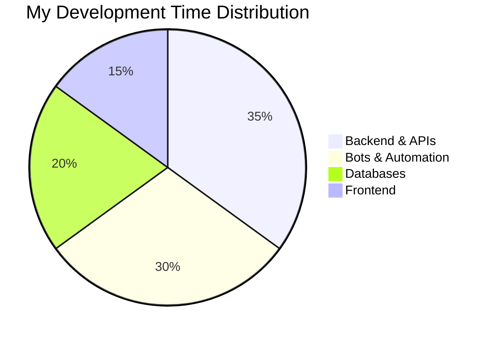

  
  
  

  

---

### 🚀 About Me

- 🔭 Building **modern web apps** and **smart communication bots**
- 🌐 My website: **[host.adevosxtech.site](https://host.adevosxtech.site)**
- 🌱 Always learning new things and improving my craft
- 👨‍💻 All projects available at **[GitHub](https://github.com/adevos-x-tech?tab=repositories)**
- 💬 Ask me about **JavaScript, Node.js, Databases, Automation, Bots**
- ⚡ Fun fact: **I love automating everything!**
- 🎯 Goals: **Contributing more to Open Source projects & building smarter automation tools**

 

---

## 🛠️ Tech Arsenal

### 🌐 Frontend

### ⚙️ Backend

### 🗄️ Databases

### 🔧 Tools & Development

### 🤖 Automation & Bots

---

## 🎯 Current Focus

  ### 🚀 **Adevos X Tech - Modern Web Apps & Smart Communication Bots**

  

  **Currently building:**

  ✨ **Modern Web Apps** | 🤖 **Smart Bots** | 🔄 **Automation**

  🚀 **High Performance** | 🗄️ **Solid Databases** | 🌐 **Clean Code**

---

## 📊 GitHub Analytics

  
  

  

  

---

## 🏆 GitHub Achievements

  

---

## 🌐 Connect With Me

  
  
  

   

  
  
  

---

## 🎯 Development Focus Areas

---

  

  ### 💭 Quote of the Day

  

  ---

  **"Code is like humor. When you have to explain it, it's bad."** – Cory House 💻✨

  

  © 2026 adevos-x-tech - Crafted with ❤️ and lots of ☕

